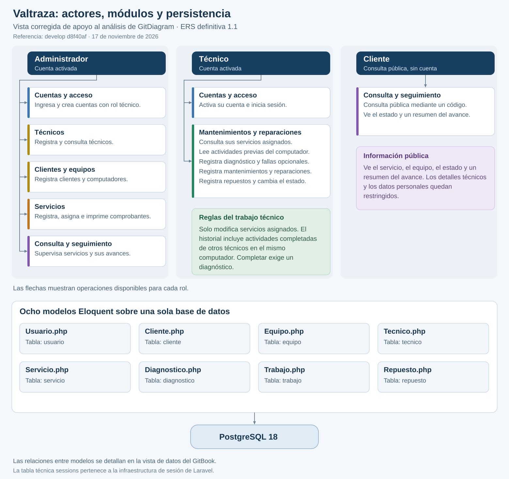

# Análisis de GitDiagram

## Diagrama público regenerado

[Diagrama interactivo](https://gitdiagram.com/meneses1111/valtraza) · [Exportación Markdown del generador](https://gitdiagram.com/meneses1111/valtraza.md)

La vista de referencia se contrastó con la ERS 1.1, el diseño y el código de Valtraza. GitDiagram genera un grafo a partir del árbol, el README y una muestra del código de la rama predeterminada. La primera generación de este repositorio se revisará tras publicar `main`.

El grafo automático puede agrupar responsabilidades u omitir controladores que no entren en su muestra. La tabla y la vista de referencia describen los seis módulos del diseño y permiten comprobar su correspondencia con el grafo.

## Responsabilidades y relaciones verificadas

| Aspecto del grafo | Referencia de Valtraza |
| --- | --- |
| Recepción y asignación | Clientes y equipos registra las personas y computadores; Servicios registra la atención y consulta Técnicos para asignar un encargado. Técnicos es un módulo propio. |
| Creación de cuentas | `CuentasController` coordina la operación y `Acceso` crea una cuenta con rol fijo de técnico. `RegistroTecnicos` registra personas; no crea cuentas. Administrador y técnico ingresan por el mismo formulario. |
| Historial del computador | La ficha administrativa utiliza `FichaClienteController` y `HistorialEquipos`. Desde un servicio asignado, el técnico lee las actividades anteriores completadas del mismo computador, incluso de otro técnico. No puede abrir ni operar directamente un servicio ajeno. |
| Trabajo técnico y estados | `RegistroTrabajoTecnico` registra diagnósticos, trabajos y repuestos en modelos distintos y aplica las clases de estado. Completar exige diagnóstico y no exige una reparación. La regla pertenece a Mantenimientos y reparaciones. |
| Consulta y seguimiento | `ConsultaPublica` usa `GestionServicios` y `LecturaAvance`; obtiene el computador a través de Servicios y expone un resumen sin datos personales ni detalles técnicos. `SupervisionServicios` proporciona la lectura administrativa completa. |
| Persistencia | Hay ocho modelos de negocio en PostgreSQL. `Trabajo.tipo` distingue mantenimiento de reparación. El cliente se obtiene por Servicio → Equipo → Cliente. `sessions` es infraestructura de sesión. |

La flecha de dependencia va del consumidor al proveedor. Las seis dependencias directas entre servicios de módulos son Cuentas y acceso → Técnicos; Servicios → Clientes y equipos y Técnicos; Mantenimientos y reparaciones → Servicios; Consulta y seguimiento → Servicios y Mantenimientos y reparaciones. El filtro administrativo de técnicos y la ficha con historial se componen desde controladores. Una flecha de relación Eloquent representa una asociación de datos y no debe confundirse con una llamada entre módulos.

La [concordancia de requisitos y diseño](../cierre/concordancia.md) identifica RF01–RF14 y las revisiones de los Talleres 1 y 2. El README del repositorio publica también el mapa de módulos y sus ubicaciones para facilitar el análisis automático. La vista siguiente es la referencia documental revisada; se distingue del resultado generado por GitDiagram.

## Vista de referencia del GitBook

[Descargar PNG](../assets/arquitectura-revisada.png) · [Abrir SVG](../assets/arquitectura-revisada.svg) · [Fuente Mermaid](../assets/actores-modulos.mmd)

| Módulo | Responsabilidad |
| --- | --- |
| Clientes y equipos | Registro de clientes y computadores, y consulta de la ficha e historial desde administración. |
| Técnicos | Registro administrativo de técnicos, consultado para asignaciones y cuentas. |
| Cuentas y acceso | Ingreso y activación, creación de cuentas de técnicos por el administrador. |
| Servicios | Registro, códigos, asignación, reasignación y comprobante. |
| Mantenimientos y reparaciones | Servicios asignados, historial de actividades completadas del computador en solo lectura, diagnósticos, trabajos, repuestos y estado. |
| Consulta y seguimiento | Supervisión administrativa y consulta del cliente por código sin cuenta. |

El [diagrama de módulos y dependencias](README.md) muestra el monolito Laravel 12 y PHP 8.3. El diagrama de actores representa el acceso por rol. Los ocho modelos de negocio persisten en PostgreSQL. `sessions` es una tabla técnica de Laravel. Consulta el [modelo de datos](../base-de-datos/modelo.md) para ver claves y relaciones.

## Fuentes de código y pruebas

- [Creación de cuentas](https://github.com/meneses1111/Valtraza/blob/main/app/Http/Controllers/CuentasController.php) y [servicio de acceso](https://github.com/meneses1111/Valtraza/blob/main/app/Services/Cuentas/Acceso.php).
- [Registro de técnicos](https://github.com/meneses1111/Valtraza/blob/main/app/Services/Tecnicos/RegistroTecnicos.php), [registro y asignación](https://github.com/meneses1111/Valtraza/blob/main/app/Http/Controllers/Servicios/ServiciosController.php) y [ficha administrativa del cliente](https://github.com/meneses1111/Valtraza/blob/main/app/Http/Controllers/Servicios/FichaClienteController.php).
- [Asignación, autorización e historial](https://github.com/meneses1111/Valtraza/blob/main/app/Services/Servicios/GestionServicios.php) y [reglas de trabajo técnico](https://github.com/meneses1111/Valtraza/blob/main/app/Services/TrabajoTecnico/RegistroTrabajoTecnico.php).
- [Ruta pública](https://github.com/meneses1111/Valtraza/blob/main/routes/modulos/consulta-publica.php) y [campos permitidos](https://github.com/meneses1111/Valtraza/blob/main/app/Services/Consulta/ConsultaPublica.php).
- [Pruebas y evidencias por versión](../pruebas/estado-y-evidencias.md).
